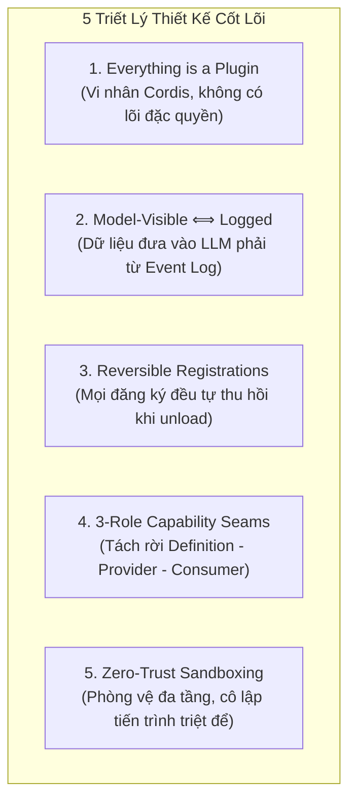
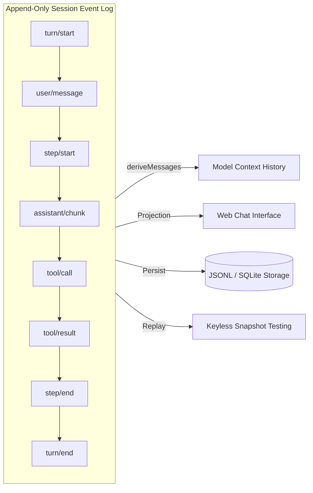
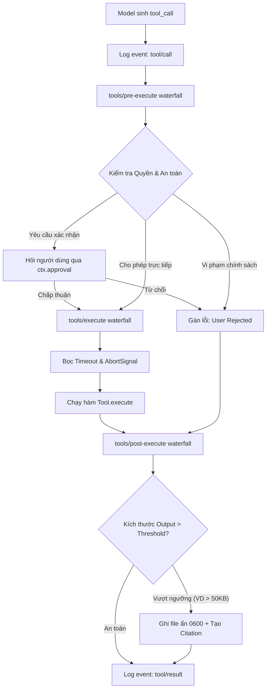

# ĐẶC TẢ KIẾN TRÚC & KHUNG THIẾT KẾ HỆ THỐNG AI AGENT (AI AGENT SYSTEM ARCHITECTURE BLUEPRINT)

> **Tài liệu chuẩn hóa kiến trúc, thiết kế mẫu (design blueprint) và giải pháp kỹ thuật cấp sản phẩm (production-grade) được đúc kết từ hệ thống DeepSeek Harness.**  
> _Mục đích:_ Làm tài liệu đặc tả kỹ thuật độc lập để bất kỳ đội ngũ kỹ sư nào có thể kế thừa, hiện thực hóa hoặc tái cấu trúc một hệ thống AI Agent Runtime thế hệ mới (trên TypeScript, Python, Go hoặc Rust).

---

## MỤC LỤC

1. [Tổng Quan & Triết Lý Thiết Kế Cốt Lõi (Core Tenets)](#1-tổng-quan--triết-lý-thiết-kế-cốt-lõi-core-tenets)
2. [Cấu Trúc Hệ Thống Phân Tầng (Layered Architecture)](#2-cấu-trúc-hệ-thống-phân-tầng-layered-architecture)
3. [Mô Hình Dữ Liệu Hướng Sự Kiện (Event-Sourced Session Architecture)](#3-mô-hình-dữ-liệu-hướng-sự-kiện-event-sourced-session-architecture)
4. [Vòng Đời Agent & Pipeline Thực Thi (Agent Loop & Waterfall Interceptors)](#4-vòng-đời-agent--pipeline-thực-thi-agent-loop--waterfall-interceptors)
5. [Mẫu Thiết Kế Năng Lực 3 Vai Trò (3-Role Capability Seam Pattern)](#5-mẫu-thiết-kế-năng-lực-3-vai-trò-3-role-capability-seam-pattern)
6. [Pipeline Thực Thi Công Cụ, Spilling & Human-in-the-Loop (Tool Execution Engine)](#6-pipeline-thực-thi-công-cụ-spilling--human-in-the-loop-tool-execution-engine)
7. [Bảo Mật Tiến Trình & Cô Lập Môi Trường (Subprocess Security & Sandboxing)](#7-bảo-mật-tiến-trình--cô-lập-môi-trường-subprocess-security--sandboxing)
8. [Cơ Chế Tự Mở Rộng Runtime (Reflective Self-Modification)](#8-cơ-chế-tự-mở-rộng-runtime-reflective-self-modification)
9. [Bộ Quy Chuẩn Kỹ Thuật Phòng Vệ (Production Defensive Patterns)](#9-bộ-quy-chuẩn-kỹ-thuật-phòng-vệ-production-defensive-patterns)
10. [Khung Mã Nguồn Triển Khai Mẫu (Reference Implementation Skeleton)](#10-khung-mã-nguồn-triển-khai-mẫu-reference-implementation-skeleton)

---

## 1. TỔNG QUAN & TRIẾT LÝ THIẾT KẾ CỐT LÕI (CORE TENETS)

Khi thiết kế một hệ thống AI Agent hoạt động ở quy mô sản xuất (thực thi mã nguồn, thao tác hệ thống tệp, gọi API, ủy quyền subagent), kiến trúc phải giải quyết được 5 bài toán nan giải: **khả năng mở rộng không giới hạn**, **tính an toàn khi thực thi mã**, **khả năng tái hiện lỗi (deterministic replay)**, **tránh rò rỉ bộ nhớ/tiến trình**, và **khả năng hoán đổi môi trường (local vs cloud sandbox)**.



### Chi tiết 5 Nguyên Lý:

1. **Everything is a Plugin (Mọi thứ đều là plugin):** Hệ thống không hardcode bất kỳ logic nghiệp vụ nào vào nhân. Từ adapter LLM, bộ công cụ (tools), cơ chế lưu trữ session, sandbox cho đến chính vòng lặp agent (`agent-loop`) đều là plugin cắm vào một Context chung và có thể thay thế bằng file cấu hình.
2. **Model-Visible ⟺ Logged (Thấy là phải ghi log):** Mọi thông điệp, ngữ cảnh hoặc kết quả công cụ mà LLM nhìn thấy **bắt buộc** phải tái tạo được 100% từ luồng sự kiện bền vững (Append-Only Event Log). Không chấp nhận trạng thái ngầm (hidden state).
3. **Reversible Registrations as Effects (Hiệu ứng có thể đảo ngược):** Mọi thao tác đăng ký dịch vụ, lắng nghe sự kiện hoặc thêm công cụ đều trả về một hàm hủy (disposer). Khi plugin bị ngắt nạp, toàn bộ tài nguyên tự động được giải phóng sạch sẽ, không gây rò rỉ bộ nhớ.
4. **Capability Seams over Monoliths:** Mỗi năng lực hệ thống (filesystem, shell, LLM, storage) đều tách rời làm 3 phần: Giao diện trừu tượng, Nhà cung cấp thực thi, và Công cụ tiêu thụ.
5. **Zero-Trust Execution & Defensive Sandboxing:** Mặc định coi mọi lệnh thực thi từ mô hình là không an toàn. Triển khai cô lập tầng kernel (Landlock/Bubblewrap/Seatbelt/MicroVMs), tẩy sạch biến môi trường bí mật và kiểm soát quyền qua Human-in-the-Loop.

---

## 2. CẤU TRÚC HỆ THỐNG PHÂN TẦNG (LAYERED ARCHITECTURE)

Hệ thống được tổ chức thành 6 tầng kiến trúc độc lập, luồng phụ thuộc chỉ đi từ trên xuống dưới (hoặc thông qua Context Service Definition):

```text
┌─────────────────────────────────────────────────────────────────────────────┐
│ 1. GIAO DIỆN & GIAO THỨC (Interfaces & Gateways)                            │
│    • Web GUI (BFF / RPC)   • Headless CLI   • JSON-RPC 2.0 SDK   • ACP Server │
├─────────────────────────────────────────────────────────────────────────────┤
│ 2. BẢO VỆ & AN TOÀN (Safety, Approvals & Guardrails)                        │
│    • Human-in-the-loop (Approval Seam)  • Rate Limiters  • Spilling Storage│
│    • Monotonic Execution Guards         • Loop-Hygiene Deadlines            │
├─────────────────────────────────────────────────────────────────────────────┤
│ 3. VÒNG ĐIỀU PHỐI CỐT LÕI (Core API Spine)                                  │
│    • Agent Registry (ctx.agents)        • System Prompt Assembly            │
│    • Agent Loop Driver (ctx.agentLoop)  • Tool Registry & Pipeline          │
│    • Session Event Sourcing (ctx.sessions)                                  │
├─────────────────────────────────────────────────────────────────────────────┤
│ 4. MÔ ĐUN NĂNG LỰC HỆ THỐNG (Capability Seams Layer)                         │
│    • LLM Adapter Seam (DeepSeek, OpenAI, Anthropic)                         │
│    • Shell / PTY Terminal Seam (Bash, PowerShell, Persistent PTY)           │
│    • Filesystem & LSP Seam (Local FS, Remote FS, Language Server)           │
│    • Subagent & Workflow Seam (Multi-agent hierarchy, Background Jobs)       │
├─────────────────────────────────────────────────────────────────────────────┤
│ 5. MÔI TRƯỜNG THỰC THI & CÔ LẬP (Execution & Sandboxing)                    │
│    • Local Process Tree (Subprocess)    • Sandboxes (Landlock, bwrap, macOS)│
│    • Remote MicroVMs (E2B / Firecracker)• Worker-Thread Code Runtime        │
├─────────────────────────────────────────────────────────────────────────────┤
│ 6. VI NHÂN NỀN TẢNG (Microkernel & Plugin Context)                          │
│    • Cordis IoC Container               • Event Emitter & Waterfalls        │
│    • Dynamic Plugin Loader              • Layered Configuration (Profiles)  │
└─────────────────────────────────────────────────────────────────────────────┘
```

### Cơ Chế Cấu Hình Xếp Lớp (Layered Composition):

- **Bundle:** Gói phân phối đóng gói cấu hình và mã nguồn plugin (VD: `base-bundle`, `web-bundle`, `headless-bundle`).
- **Profile:** Định danh các bundle cần nạp cho từng mục đích sử dụng (`--profile web` hoặc `--profile headless`).
- **Patch Layer (`cordis.patch.yml`):** Lớp ghi đè cho phép thay thế hoặc chèn thêm bất kỳ plugin nào vào runtime mà không cần sửa đổi mã nguồn gốc.

---

## 3. MÔ HÌNH DỮ LIỆU HƯỚNG SỰ KIỆN (EVENT-SOURCED SESSION ARCHITECTURE)

Hệ thống loại bỏ hoàn toàn mô hình lưu trữ Mutable State (sửa trực tiếp mảng tin nhắn). Thay vào đó, toàn bộ phiên làm việc của Agent là một **luồng sự kiện bất biến (Append-Only Event Stream)**.



### 3.1. Phân loại Sự kiện (Event Domains):

1. **Durable Session Events (Bền vững):** Ghi trực tiếp vào file log (JSONL/SQLite). Sống sót qua restart và dùng để tái tạo ngữ cảnh:
   - `turn/start`, `turn/end`, `step/start`, `step/end`
   - `user/message`, `assistant/chunk`, `assistant/message`
   - `tool/call`, `tool/result`
   - `plan/state`, `todo/write`
2. **Ephemeral Agent Events (Runtime):** Sự kiện live trong bộ nhớ để quan sát và can thiệp chu kỳ hoạt động:
   - `agent/pre-step`, `agent/request`, `agent/turn-stopping`
3. **Capability Events (Chính sách):** Sự kiện cục bộ gắn với từng năng lực (`fs/write-intent`, `tools/pre-execute`).

### 3.2. Chuẩn Projection `deriveMessages(log)`:

Một hàm thuần túy (pure function) biến đổi danh sách `SessionEvent[]` thành danh sách tin nhắn chuẩn cho LLM (`ChatMessage[]`):

- Gộp các `assistant/chunk` thành một `assistant` message hoàn chỉnh.
- Ghép cặp chính xác giữa `tool/call` và `tool/result` tương ứng thông qua `toolCallId`.
- Loại bỏ dữ liệu thừa hoặc đã được spill ra bộ nhớ ngoài.

### 3.3. Session Forking & Deterministic Replay:

- **Session Forking (`ctx.sessions.fork`):** Tạo một phiên làm việc mới bằng cách copy luồng sự kiện từ phiên cũ tới một mốc thời gian (event index) chỉ định. Cho phép người dùng hoặc agent thử nghiệm các hướng giải quyết rẽ nhánh (branching exploration).
- **Keyless Snapshot Testing:** Phát lại (replay) toàn bộ luồng sự kiện từ log có sẵn để chạy Unit/Integration Test trong CI/CD với chi phí **$0 API**, đảm bảo không bao giờ làm vỡ logic xử lý tool hay pipeline.

---

## 4. VÒNG ĐỜI AGENT & PIPELINE THỰC THI (AGENT LOOP & WATERFALL INTERCEPTORS)

### 4.1. Khái niệm Ngữ Nghĩa: Turn vs Step

- **Step (Bước):** Một chu kỳ tính toán đơn lẻ gồm: Gửi ngữ cảnh tới LLM $\rightarrow$ Nhận phản hồi $\rightarrow$ Thực thi các Tool được yêu cầu $\rightarrow$ Thu thập kết quả.
- **Turn (Lượt):** Một phiên giải quyết trọn vẹn yêu cầu từ Inbox cho đến khi hoàn thành mục tiêu (bao gồm một hoặc nhiều Step liên tiếp).

### 4.2. Sơ Đồ Pipeline Thực Thi Tuần Tự (Turn Execution Flow)

```mermaid
sequenceDiagram
    autonumber
    participant Inbox as Inbox & Context
    participant Loop as Agent Loop Driver
    participant WF as Waterfall Interceptors
    participant LLM as LLM Provider
    participant Tools as Tool Pipeline
    participant Log as Session Event Log

    Note over Loop: Bắt đầu Turn mới
    Loop->>Log: Ghi nhận event turn/start
    Loop->>Inbox: Lấy user input + Context đính kèm
    Loop->>WF: Kích hoạt agent/pre-step (Kiểm duyệt, viết lại prompt)
    WF-->>Loop: Trả về entered messages

    loop Mỗi Step (cho đến khi hoàn thành)
        Loop->>Log: Ghi nhận step/start & user/message
        Loop->>Log: deriveMessages() tạo ngữ cảnh
        Loop->>WF: Kích hoạt agent/request
        Loop->>LLM: Stream prompt -> assistant/chunk*
        LLM-->>Loop: Hoàn tất assistant/message + danh sách tool_calls

        opt Nếu có tool_calls
            Loop->>Tools: Gửi danh sách tool calls
            Tools->>WF: tools/pre-execute (Check quyền, Permission)
            Tools->>Tools: Thực thi Tool logic (bọc Timeout, Sandboxing)
            Tools->>WF: tools/post-execute (Filter kết quả, Spilling)
            Tools->>Log: Ghi nhận tool/result
        end
        Loop->>Log: Ghi nhận step/end
    end

    Loop->>WF: Kích hoạt agent/turn-stopping (Xác nhận điều kiện dừng)
    Loop->>Log: Ghi nhận turn/end
    Note over Loop: Kết thúc Turn
```

### 4.3. Cơ chế Waterfall Chain (Chuỗi Xử Lý Thác Nước)

Trong pipeline, các sự kiện cốt lõi (`agent/pre-step`, `agent/request`, `tools/pre-execute`, `tools/execute`, `tools/post-execute`) được tổ chức theo mô hình **Waterfall**:

- Mỗi listener nhận vào `(payload, next)`.
- Listener có toàn quyền thay đổi `payload`, bọc thêm logic đo lường hoặc ủy quyền tiếp bằng cách gọi `return next(modifiedPayload)`.
- Nếu listener không gọi `next()`, chuỗi sẽ lập tức bị ngắt (Short-circuit), phục vụ cho việc chặn prompt độc hại hoặc từ chối thực thi lệnh nguy hiểm.

---

## 5. MẪU THIẾT KẾ NĂNG LỰC 3 VAI TRÒ (3-ROLE CAPABILITY SEAM PATTERN)

Để hệ thống có thể chạy trên máy nội bộ lập trình viên, vừa có thể chuyển sang chạy trên Kubernetes hay Cloud Sandbox (E2B) mà **không phải viết lại Tool**, kiến trúc bắt buộc tuân theo mẫu 3 vai trò:

```text
┌─────────────────────────────────────────────────────────────────────────────┐
│ 1. SERVICE DEFINITION (Giao diện trừu tượng chuẩn hóa)                      │
│    Khai báo abstract methods, chuẩn hóa mã lỗi, gắn vào Context key         │
│    VD: FileSystemService -> ctx.fs                                          │
├─────────────────────────────────────────────────────────────────────────────┤
│ 2. SERVICE PROVIDERS (Các bản cài đặt đa hình tại runtime)                  │
│    ┌───────────────────────────┐         ┌────────────────────────────────┐ │
│    │ LocalFileSystemProvider   │         │ E2BCloudSandboxFSProvider      │ │
│    │ (Thao tác fs Node.js)     │   HOẶC  │ (Thao tác qua REST/gRPC Cloud) │ │
│    └───────────────────────────┘         └────────────────────────────────┘ │
├─────────────────────────────────────────────────────────────────────────────┤
│ 3. CONSUMERS / TOOLS (Công cụ giao tiếp với LLM hoặc UI)                    │
│    Chỉ gọi qua ctx.fs trừu tượng, hoàn toàn không biết môi trường bên dưới   │
│    VD: tool_read_file, tool_write_file, tool_directory_list                 │
└─────────────────────────────────────────────────────────────────────────────┘
```

### Lợi ích Đột Phá:

Khi người dùng chuyển cấu hình từ Local sang Remote Sandbox:

- Hệ thống chỉ cần hoán đổi Provider của `ctx.fs` và `ctx.subprocess`.
- Toàn bộ các công cụ như `bash`, `terminal`, `lsp`, `grep`, `file-write` sẽ tự động thực thi trong môi trường sandbox cô lập trên mây mà **không cần chỉnh sửa một dòng code nào trong các Tool!**

---

## 6. PIPELINE THỰC THI CÔNG CỤ, SPILLING & HUMAN-IN-THE-LOOP (TOOL EXECUTION ENGINE)



### 6.1. Human-in-the-Loop & Approval Seam

- Hệ thống cung cấp dịch vụ `ctx.approval`.
- Khi một tool có mức độ rủi ro cao (VD: `rm -rf`, ghi đè cấu hình nhạy cảm), pipeline tạm dừng và phát tín hiệu yêu cầu người dùng xác nhận (`approve` / `deny`).
- Hỗ trợ cơ chế phân quyền (Permission Presets): `auto-approve` (tự động chạy), `prompt-on-write` (hỏi khi sửa đổi), hoặc `read-only` (chặn toàn bộ lệnh ghi).

### 6.2. Cơ Chế Chống Tràn Ngữ Cảnh (Tool Output Spilling)

- **Vấn đề:** Khi tool trả về output khổng lồ (VD: đọc log 50MB hoặc file nhị phân lớn), gửi trực tiếp vào prompt sẽ làm tràn Context Window và tốn kém chi phí token.
- **Giải pháp:** Nếu output vượt quá ngưỡng quy định (VD: `50KB`), hệ thống tự động:
  1. Ghi toàn bộ dữ liệu thô vào bộ nhớ an toàn (spill storage) với phân quyền nghiêm ngặt (`0600`).
  2. Tạo mã băm định danh (`citation_id`).
  3. Trả về cho mô hình bản trích xuất ngắn (summary + preview 50 dòng đầu) kèm thông báo: _"Dữ liệu đã được lưu trữ an toàn tại mã tham chiếu citation_xyz. Sử dụng công cụ read_spill để đọc các dòng tiếp theo khi cần."_

---

## 7. BẢO MẬT TIẾN TRÌNH & CÔ LẬP MÔI TRƯỜNG (SUBPROCESS SECURITY & SANDBOXING)

Mọi hệ thống Agent tự động hóa đều tiềm ẩn nguy cơ bảo mật nghiêm trọng nếu để mô hình thực thi mã tự do. Hệ thống áp dụng chiến lược **Phòng thủ Đa tầng (Defense-in-Depth)**:

```text
┌─────────────────────────────────────────────────────────────────────────────┐
│                             MA TRẬN CÔ LẬP TIẾN TRÌNH                       │
├───────────────┬─────────────────────────────────────────────────────────────┤
│ Linux         │ • Landlock LSM (Giới hạn truy cập FS ở cấp Linux Kernel)    │
│               │ • Bubblewrap (bwrap - Cô lập PID, IPC, Network, Mount)      │
├───────────────┼─────────────────────────────────────────────────────────────┤
│ macOS         │ • Seatbelt (sandbox-exec với profile .sb định nghĩa trước)  │
├───────────────┼─────────────────────────────────────────────────────────────┤
│ Cloud Sandbox │ • MicroVMs (E2B / Firecracker - Môi trường ảo hóa hoàn toàn)│
└───────────────┴─────────────────────────────────────────────────────────────┘
```

### Các Quy Tắc An Toàn Bắt Buộc (Mandatory Security Rules):

1. **Env Scrubbing (Tẩy sạch biến môi trường):** Trước khi spawn bất kỳ tiến trình con nào (Bash, Node.js, Python), bắt buộc phải lọc sạch toàn bộ biến môi trường chứa `*KEY*`, `*SECRET*`, `*TOKEN*`, `*PASSWORD*`, `*CREDENTIALS*` để ngăn LLM in trộm biến môi trường ra ngoài.
2. **Symlink Traversal Prevention (Chống leo thang Symbolic Link):** Sử dụng `lstatSync` kiểm tra cẩn thận trước khi xóa hoặc duyệt file. Tuyệt đối không gọi `rmdir` đệ quy bừa bãi khi chưa chuẩn hóa đường dẫn (`realPath`), tránh việc symlink trỏ ra ngoài workspace làm xóa sạch dữ liệu hệ thống máy chủ.
3. **Quiescent Process Tree Teardown (Thu hồi tiến trình sạch sẽ):** Khi hủy một lệnh (Cancel/Timeout), không chỉ gửi `kill(PID)` mà phải gửi `SIGTERM`/`SIGKILL` tới toàn bộ cây tiến trình con (Process Tree) và `await child.exit` để triệt tiêu hoàn toàn tiến trình mồ côi (zombie processes).

---

## 8. CƠ CHẾ TỰ MỞ RỘNG RUNTIME (REFLECTIVE SELF-MODIFICATION)

Điểm đột phá của kiến trúc dựa trên Vi nhân Cordis là khả năng **tự phản chiếu và mở rộng runtime (Self-Modification)**:

1. **Self-Inspection (Tự nội soi):** Agent có thể gọi công cụ để tự tra cứu danh sách toàn bộ plugin, service, và tool schema hiện đang có trong runtime của chính nó.
2. **Dynamic Hot-Mounting (Nạp nóng plugin):** Khi gặp bài toán phức tạp đòi hỏi công cụ chuyên biệt, Agent có thể:
   - Tự viết mã nguồn một plugin Cordis mới ra tệp tin.
   - Gọi công cụ `mount_extension(path)`.
   - Runtime sẽ nạp nóng (hot-load) plugin đó vào Context ngay lập tức mà **không cần khởi động lại server**, mang lại các công cụ mới cho Agent sử dụng ngay ở Step kế tiếp!

---

## 9. BỘ QUY CHUẨN KỸ THUẬT PHÒNG VỆ (PRODUCTION DEFENSIVE PATTERNS)

Các bài học kỹ thuật thực chiến đúc kết thành checklist tiêu chuẩn:

### 9.1. Báo Cáo Kết Quả Trực Giao Độc Lập (Orthogonal Outcome Reporting)

- Không được gom gộp các trạng thái kết thúc vào một biến duy nhất.
- Luôn trả về cấu trúc kết quả độc lập rõ ràng:
  ```typescript
  interface SubprocessResult {
    timedOut: boolean; // Có bị quá thời gian không?
    aborted: boolean; // Có bị người dùng hủy không?
    exitCode: number | null; // Mã thoát tiến trình
    signal: string | null; // Tín hiệu kết thúc (SIGTERM, SIGKILL)
    stdout: string;
    stderr: string;
  }
  ```

### 9.2. Định Danh Opaque An Toàn Kiểu (Branded Types)

- Không dùng `string` trần trụi cho các ID nhạy cảm để tránh truyền nhầm tham số tại compile-time:
  ```typescript
  export type Brand<K, T> = K & { readonly __brand: T };
  export type SessionId = Brand<string, "SessionId">;
  export type ToolCallId = Brand<string, "ToolCallId">;
  export type TurnId = Brand<string, "TurnId">;
  ```

### 9.3. Đóng Gói Ngoại Lệ Dispatcher (Resilient Dispatching)

- Khi duyệt danh sách event listeners, nếu một listener của bên thứ ba ném ngoại lệ (`throw Error`), dispatcher phải `try...catch` và log lại, tuyệt đối không để crash luồng xử lý chính hoặc bỏ đói (starve) các listener kế tiếp.

### 9.4. Bất Biến Dữ Liệu Bền Vững (Data Versioning Invariants)

- Mọi cấu trúc lưu trữ durable phải có trường `SCHEMA_VERSION`.
- Khi format dữ liệu thay đổi, hệ thống phải từ chối hoặc có migration adapter rõ ràng, không bao giờ đọc dữ liệu sai lệch gây crash ngầm.

---

## 10. KHUNG MÃ NGUỒN TRIỂN KHAI MẪU (REFERENCE IMPLEMENTATION SKELETON)

Dưới đây là khung mã nguồn TypeScript tối giản nhưng hoàn chỉnh, mô phỏng lại toàn bộ kiến trúc trên để một hệ thống mới có thể bắt đầu kế thừa ngay lập tức:

### 10.1. Khung Microkernel Context & Service Base

```typescript
// runtime/context.ts
export type Disposer = () => void;

export class Context {
  private services = new Map<string, any>();
  private listeners = new Map<string, Array<(...args: any[]) => any>>();

  provide(name: string, instance: any): Disposer {
    this.services.set(name, instance);
    this.emit(`service:${name}`, instance);
    return () => {
      this.services.delete(name);
      this.emit(`service-removed:${name}`, null);
    };
  }

  get<T>(name: string): T {
    const svc = this.services.get(name);
    if (!svc) throw new Error(`Service '${name}' chưa được nạp vào Context!`);
    return svc as T;
  }

  on(event: string, handler: (...args: any[]) => any): Disposer {
    if (!this.listeners.has(event)) this.listeners.set(event, []);
    this.listeners.get(event)!.push(handler);
    return () => {
      const arr = this.listeners.get(event) || [];
      const idx = arr.indexOf(handler);
      if (idx !== -1) arr.splice(idx, 1);
    };
  }

  emit(event: string, payload: any): void {
    const list = this.listeners.get(event) || [];
    for (const fn of list) {
      try {
        fn(payload);
      } catch (err) {
        console.error(`[Event Error] Lỗi khi dispatch event '${event}':`, err);
      }
    }
  }

  async waterfall<T>(event: string, initialPayload: T): Promise<T> {
    const list = [...(this.listeners.get(event) || [])];
    let index = 0;
    const next = async (currPayload: T): Promise<T> => {
      if (index >= list.length) return currPayload;
      const handler = list[index++];
      return await handler(currPayload, next);
    };
    return await next(initialPayload);
  }
}
```

### 10.2. Khung Capability Seam Mẫu (Filesystem Seam)

```typescript
// capabilities/fs/service-definition.ts
export interface FileSystemService {
  readFile(path: string): Promise<string>;
  writeFile(path: string, content: string): Promise<void>;
  listDirectory(path: string): Promise<string[]>;
}

// capabilities/fs/local-provider.ts
import * as fs from "fs/promises";
import { Context } from "../../runtime/context";
import { FileSystemService } from "./service-definition";

export function applyLocalFS(ctx: Context) {
  const localFS: FileSystemService = {
    async readFile(p) {
      return await fs.readFile(p, "utf-8");
    },
    async writeFile(p, c) {
      return await fs.writeFile(p, c, "utf-8");
    },
    async listDirectory(p) {
      return await fs.readdir(p);
    },
  };
  return ctx.provide("fs", localFS);
}
```

### 10.3. Khung Khai Báo Tool & Thực Thi Có Bảo Vệ (Protected Tool Engine)

```typescript
// tools/tool-registry.ts
import { Context } from "../runtime/context";
import { FileSystemService } from "../capabilities/fs/service-definition";

export interface ToolDefinition<TArgs = any, TResult = any> {
  name: string;
  description: string;
  parameters: Record<string, any>; // JSON Schema
  execute: (args: TArgs, ctx: Context) => Promise<TResult>;
}

export class ToolRegistry {
  private tools = new Map<string, ToolDefinition>();

  constructor(private ctx: Context) {}

  register(tool: ToolDefinition) {
    this.tools.set(tool.name, tool);
    return () => this.tools.delete(tool.name);
  }

  async executeTool(name: string, rawArgs: any): Promise<any> {
    const tool = this.tools.get(name);
    if (!tool) throw new Error(`Tool ${name} không tồn tại!`);

    // 1. Tiền xử lý (Waterfall Interceptor: Check quyền, Permission)
    const prePayload = await this.ctx.waterfall("tools/pre-execute", { name, args: rawArgs });

    // 2. Thực thi Tool
    let result: any;
    try {
      result = await tool.execute(prePayload.args, this.ctx);
    } catch (err: any) {
      result = { error: err.message || String(err) };
    }

    // 3. Hậu xử lý (Waterfall: Spilling, Output Filtering)
    const postPayload = await this.ctx.waterfall("tools/post-execute", { name, result });
    return postPayload.result;
  }
}
```

### 10.4. Khung Vòng Lặp Agent Loop Chuẩn (The Agent Loop Driver)

```typescript
// loop/agent-loop.ts
import { Context } from "../runtime/context";
import { ToolRegistry } from "../tools/tool-registry";

export class AgentLoopDriver {
  constructor(
    private ctx: Context,
    private tools: ToolRegistry
  ) {}

  async runTurn(sessionId: string, initialUserMessage: string): Promise<void> {
    this.ctx.emit("turn/start", { sessionId });

    // 1. Lọc và duyệt prompt đầu vào qua Waterfall
    const { message: acceptedPrompt } = await this.ctx.waterfall("agent/pre-step", {
      message: initialUserMessage,
    });

    let continueTurn = true;
    let stepCount = 0;
    const MAX_STEPS = 20;

    while (continueTurn && stepCount < MAX_STEPS) {
      stepCount++;
      this.ctx.emit("step/start", { sessionId, stepCount });

      // 2. Lấy Service LLM và gọi Stream
      const llm = this.ctx.get<any>("llm");
      const response = await llm.generateChatCompletion({ prompt: acceptedPrompt });

      // 3. Thực thi Tool nếu có yêu cầu
      if (response.toolCalls && response.toolCalls.length > 0) {
        for (const call of response.toolCalls) {
          const toolResult = await this.tools.executeTool(call.name, call.arguments);
          this.ctx.emit("tool/result", { callId: call.id, toolResult });
        }
        // Vẫn còn tool cần giải quyết -> tiếp tục loop
        continueTurn = true;
      } else {
        // Mô hình đã trả lời xong và không yêu cầu thêm tool -> dừng
        continueTurn = false;
      }

      this.ctx.emit("step/end", { sessionId, stepCount });
    }

    this.ctx.emit("turn/end", { sessionId });
  }
}
```

---

## 11. BẢNG ĐỐI CHIẾU THUẬT NGỮ & CHỈ DẪN KẾ THỪA

| Thuật ngữ trong DeepSeek Harness | Khái niệm Kỹ thuật Tương đương                              | Lời khuyên khi Triển khai Hệ thống Mới                                                       |
| -------------------------------- | ----------------------------------------------------------- | -------------------------------------------------------------------------------------------- |
| **Cordis Context (`ctx`)**       | Inversion of Control (IoC) / Dependency Injection Container | Dùng một Context phân cấp nhẹ để quản lý lifecycle thay vì singleton toàn cục.               |
| **Capability Seams**             | Hexagonal Architecture / Ports and Adapters                 | Luôn tách rời Service Definition $\rightarrow$ Provider $\rightarrow$ Tool Consumer.         |
| **Session Event Log**            | Event Sourcing Architecture                                 | Lưu log dạng Append-Only (JSONL/SQLite) làm Single Source of Truth cho toàn bộ Agent.        |
| **Waterfall Listeners**          | Express/Koa Middleware Chain                                | Cho phép các plugin chặn, sửa hoặc hủy luồng dữ liệu trước khi gửi tới LLM hoặc OS.          |
| **Spilling Storage**             | Off-band Blob Storage & Token Paging                        | Luôn kiểm soát độ dài của Tool Output, lưu file ra đĩa và trả về mã tham chiếu (`citation`). |
| **Keyless Snapshot Replay**      | Deterministic Record & Replay Mocking                       | Xây dựng bộ replay event để test CI/CD mà không mất tiền gọi API LLM thật.                   |

---

_Bản đặc tả này đóng vai trò như một bộ khung thiết kế mẫu hoàn chỉnh (Architecture Blueprint), có thể dùng làm tài liệu tham chiếu kỹ thuật cho bất kỳ hệ thống AI Agent nào trong tương lai._
